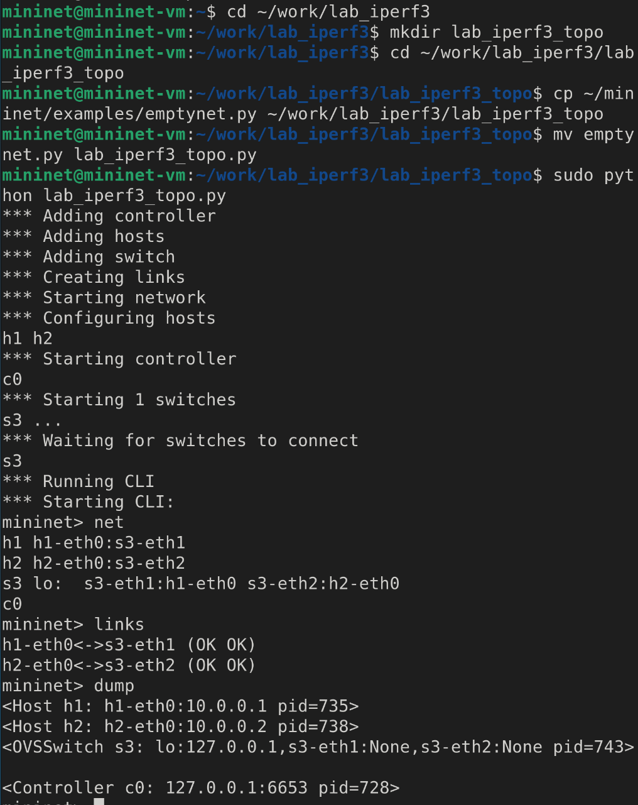
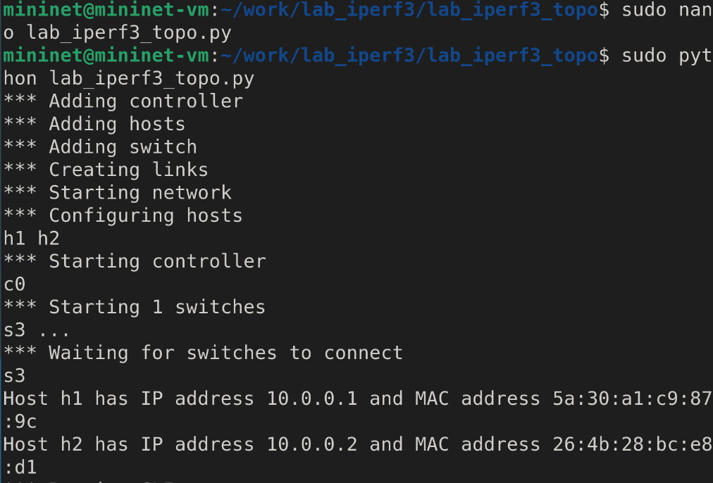
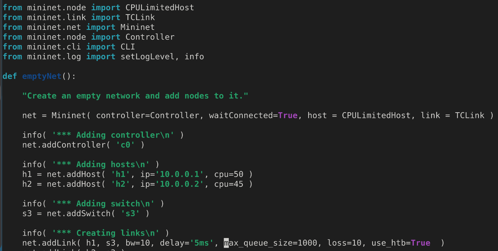
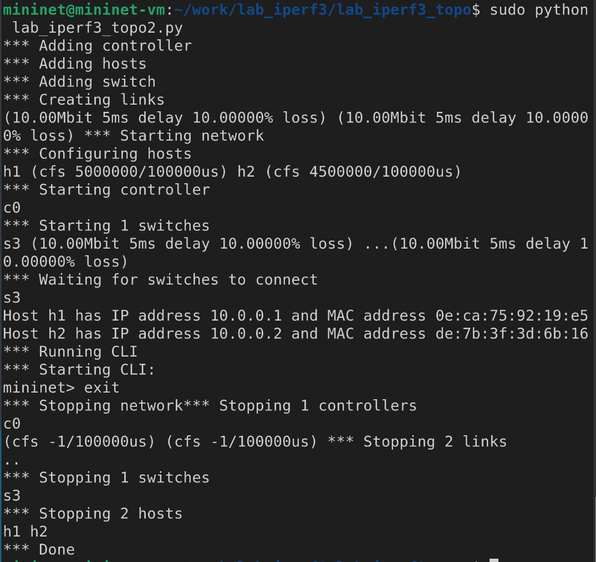
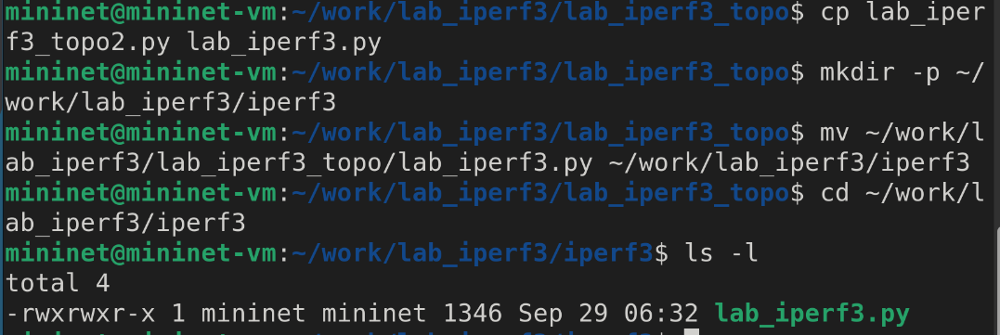
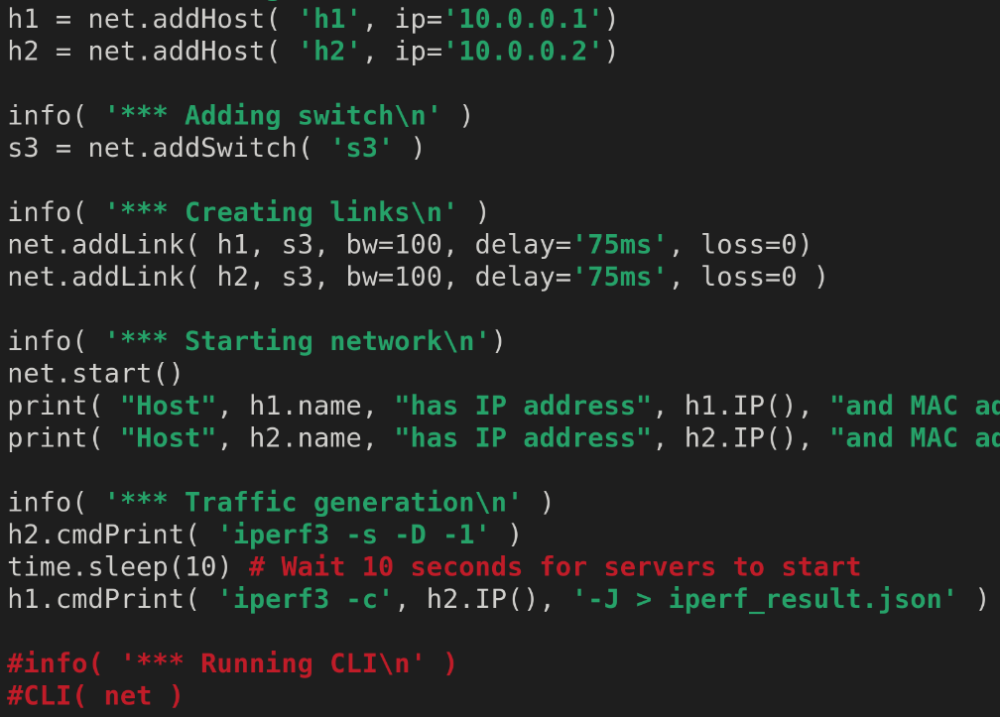
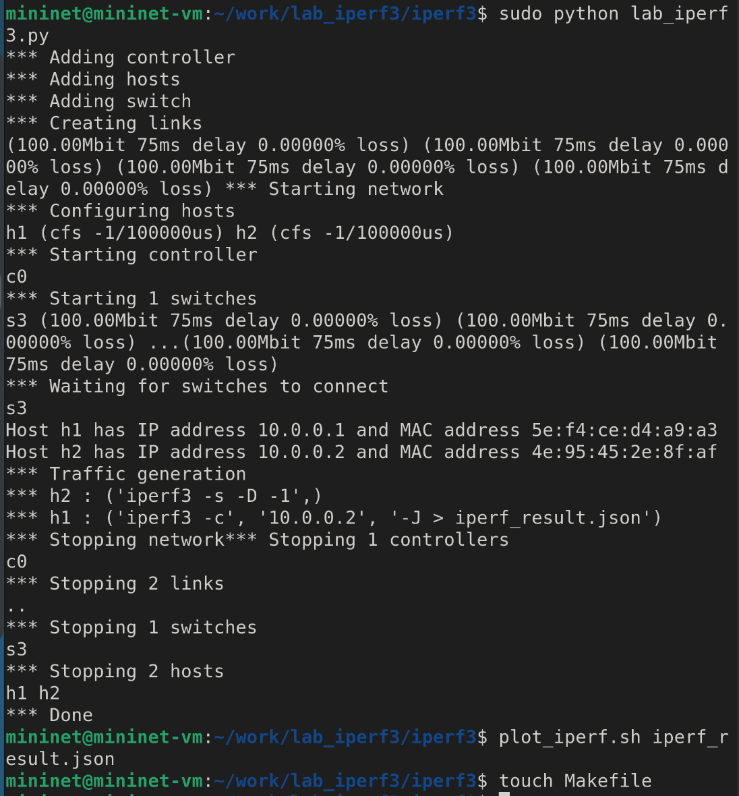
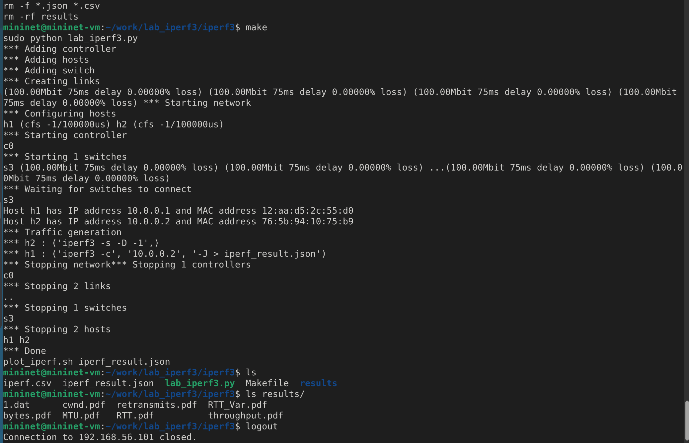

---
## Front matter
lang: ru-RU
title: Лабораторная работа
subtitle: Номер 3
author:
  - Кобзев Д. К. 
institute:
  - Российский университет дружбы народов, Москва, Россия
date: 29 сентября 2026

## i18n babel
babel-lang: russian
babel-otherlangs: english

## Pdf output format
fontsize: 8pt

## Formatting pdf
toc: false
toc-title: Содержание
slide_level: 2
aspectratio: 169
section-titles: true
theme: metropolis
##Fonts
mainfont: Liberation Serif
sansfont: Liberation Sans
monofont: Liberation Mono
---

# Информация

## Докладчик

:::::::::::::: {.columns align=center}
::: {.column width="70%"}

  * Кобзев Дмитрий Константинович
  * Студент
  * Российский университет дружбы народов
  * НПИбд-01-23

:::
::: {.column width="30%"}

:::
::::::::::::::

## Цель работы

Целью данной работы является знакомство с инструментом для измерения пропускной способности сети в режиме реального времени — iPerf3, а также получение навыков проведения воспроизводимого эксперимента по измерению пропускной способности моделируемой сети в среде Mininet.

## Измерение и тестирование пропускной способности сети

В каталоге /work/lab_iperf3 для работы над проектом создаем подкаталог lab_iperf3_topo и копируем в него файл с примером скрипта mininet/examples/emptynet.py, описывающего стандартную простую топологию сети mininet.
Запускаем скрипт создания топологии lab_iperf3_topo.py.
После отработки скрипта смотрим элементы топологии и завершаем работу mininet(Рис. 1.1).

{height=60%}

## Измерение и тестирование пропускной способности сети

Вносим в скрипт lab_iperf3_topo.py изменение, позволяющее вывести на экран информацию о обоих хостах.
Проверяем корректность отработки изменённого скрипта (Рис. 1.2).

{height=60%}

## Измерение и тестирование пропускной способности сети

Делаем копию скрипта lab_iperf3_topo.py.
В начале скрипта lab_iperf3_topo2.py добавляем записи об импорте классов CPULimitedHost и TCLink.
Изменяем строку описания сети, указав на использование ограничения производительности и изоляции.
Изменяем функцию задания параметров виртуального хоста h1, указав, что ему будет выделено 50% от общих ресурсов процессора системы. Аналогичным образом для хоста h2 задаем долю выделения ресурсов процессора в 45%. 
Изменяем функцию параметров соединения между хостом h1 и коммутатором s3 (Рис. 1.3), (Рис. 1.4).

{height=60%}

## Измерение и тестирование пропускной способности сети

{height=60%}

## Измерение и тестирование пропускной способности сети

Строим графики по проводимому эксперименту. Делаем копию скрипта lab_iperf3_topo2.py и поместите его в подкаталог iperf (Рис. 1.5).

{height=60%}

## Измерение и тестирование пропускной способности сети

Изменяем код в скрипте lab_iperf3.py так, чтобы:
– на хостах не было ограничения по использованию ресурсов процессора;
– каналы между хостами и коммутатором были по 100 Мбит/с с задержкой 75 мс, без потерь, без использования ограничителей пропускнойспособности и максимального размера очереди.
– После функции старта сети описываем запуск на хосте h2 сервера iPerf3, а на хосте h1 запуск с задержкой в 10 секунд клиента iPerf3 с экспортом результатов в JSON-файл, комментируем строки, отвечающие за запуск CLI-интерфейса (Рис. 1.6).

{height=60%}

## Измерение и тестирование пропускной способности сети

Запускаем на отработку скрипт lab_iperf3.py.
Строим графики из получившегося JSON-файла.
Создаем Makefile для проведения всего эксперимента (Рис. 1.7).

{height=60%}

## Измерение и тестирование пропускной способности сети

В Makefile прописываем запуск скрипта эксперимента, построение графиков и очистку каталога от результатов.
Проверяем корректность отработки Makefile.
Завершаем соединение с виртуальной машиной mininet и выключите её (Рис. 1.8).

{height=60%}

## Выводы

В результате выполнения лабораторной работы я был знакомлен с инструментом для измерения пропускной способности сети в режиме реального времени — iPerf3, а также получил навыки проведения воспроизводимого эксперимента по измерению пропускной способности моделируемой сети в среде Mininet.
