---
## Front matter
lang: ru-RU
title: Лабораторная работа
subtitle: Номер 4
author:
  - Кобзев Д. К. 
institute:
  - Российский университет дружбы народов, Москва, Россия
date: 6 октября 2026

## i18n babel
babel-lang: russian
babel-otherlangs: english

## Pdf output format
fontsize: 8pt

## Formatting pdf
toc: false
toc-title: Содержание
slide_level: 2
aspectratio: 169
section-titles: true
theme: metropolis
##Fonts
mainfont: Liberation Serif
sansfont: Liberation Sans
monofont: Liberation Mono
---

# Информация

## Докладчик

:::::::::::::: {.columns align=center}
::: {.column width="70%"}

  * Кобзев Дмитрий Константинович
  * Студент
  * Российский университет дружбы народов
  * НПИбд-01-23

:::
::: {.column width="30%"}

:::
::::::::::::::

## Цель работы

Целью данной работы является знакомство с NETEM — инструментом для тестирования производительности приложений в виртуальной сети, а также получение навыков проведения интерактивного и воспроизводимого экспериментов по измерению задержки и её дрожания (jitter) в моделируемой сети в среде Mininet.

## Запуск лабораторной топологии

Запускаем виртуальную среду с mininet.
Из основной ОС подключаемся к виртуальной машине.
В виртуальной машине mininet исправляем права запуска X-соединения.
Задаем простейшую топологию, состоящую из двух хостов и коммутатора с назначенной по умолчанию mininet сетью 10.0.0.0/8.
На хостах h1 и h2 вводим команду ifconfig, чтобы отобразить информацию, относящуюся к их сетевым интерфейсам и назначенным им IP-адресам.
Проверяем подключение между хостами h1 и h2 с помощью команды ping с параметром -c 6(Рис. 1.1).

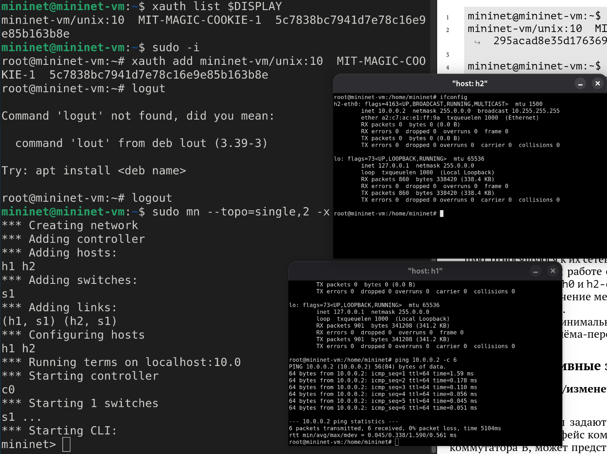{height=60%}

## Добавление/изменение задержки в эмулируемой глобальной сети

На хосте h1 добавляем задержку в 100 мс к выходному интерфейсу.
Проверяем, что соединение от хоста h1 к хосту h2 имеет задержку 100 мс, используя команду ping с параметром -c 6 с хоста h1.
Для эмуляции глобальной сети с двунаправленной задержкой к соответствующему интерфейсу на хосте h2 также добавляем задержку в 100 миллисекунд.
Проверяем, что соединение между хостом h1 и хостом h2 имеет RTT в 200 мс, повторив
команду ping с параметром -c 6 на терминале хоста h1 (Рис. 1.2).

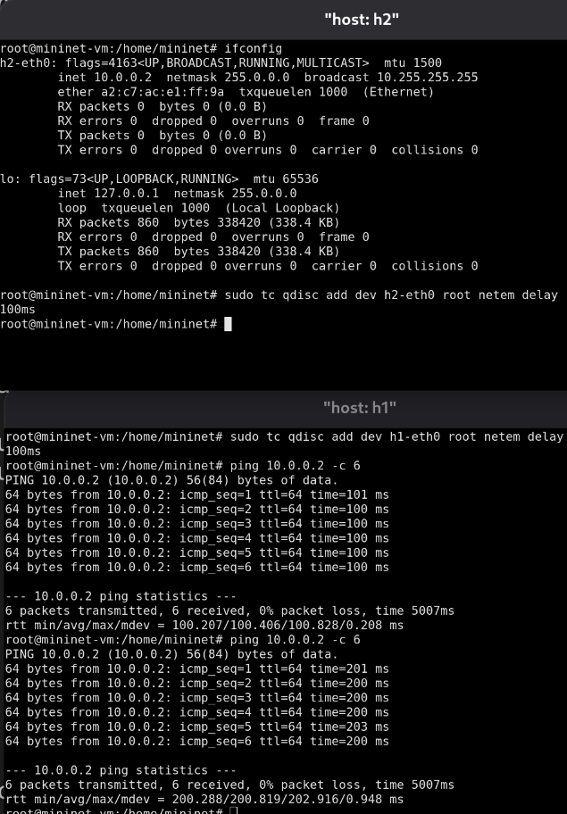{height=60%}

## Изменение задержки в эмулируемой глобальной сети

Изменяем задержку со 100 мс до 50 мс для отправителя h1 и для получателя h2.
Проверяем, что соединение от хоста h1 к хосту h2 имеет задержку 100 мс, используя команду ping с параметром -c 6 с терминала хоста h1 (Рис. 1.3).

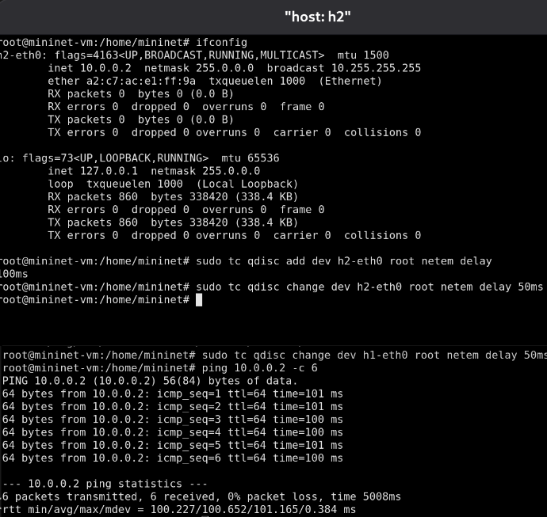{height=60%}

## Восстановление исходных значений (удаление правил) задержки в эмулируемой глобальной сети

Восстанавливаем конфигурацию по умолчанию, удалив все правила, применённые к сетевому планировщику соответствующего интерфейса.
Проверяем, что соединение между хостом h1 и хостом h2 не имеет явно установленной задержки, используя команду ping с параметром -c 6 с терминала хоста h1 (Рис. 1.4)

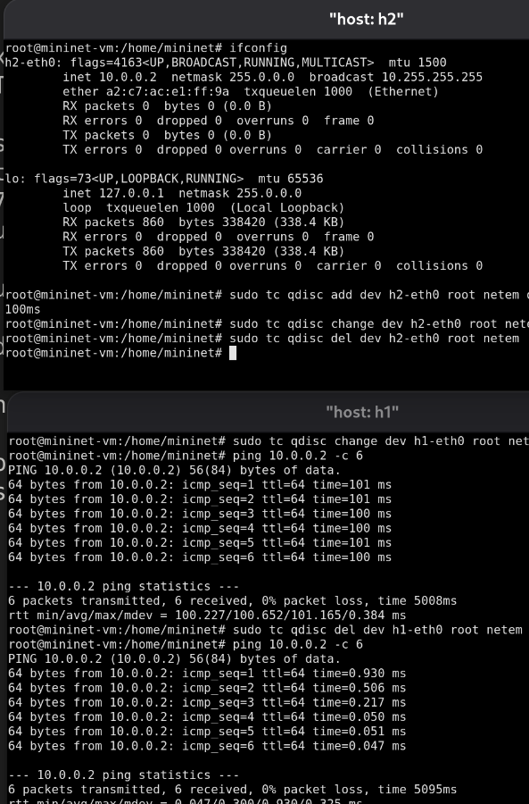{height=60%}

## Добавление значения дрожания задержки в интерфейс подключения к эмулируемой глобальной сети

Добавляем на узле h1 задержку в 100 мс со случайным отклонением 10 мс.
Проверяем, что соединение от хоста h1 к хосту h2 имеет задержку 100 мс со случайным отклонением ±10 мс, используя в терминале хоста h1 команду ping с параметром -c 6. Восстанавливаем конфигурацию интерфейса по умолчанию на узле h1 (Рис. 1.5).

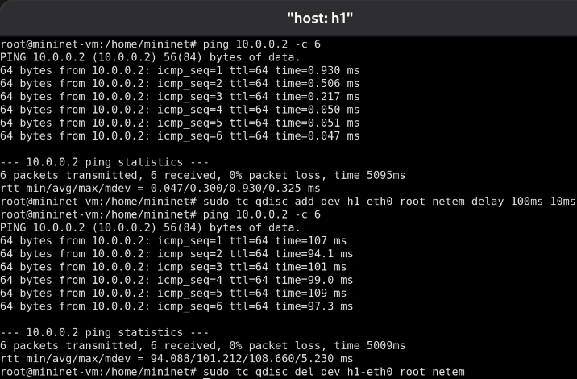{height=60%}

## Добавление значения корреляции для джиттера и задержки в интерфейс подключения к эмулируемой глобальной сети

Добавляем на интерфейсе хоста h1 задержку в 100 мс с вариацией ±10 мс и значением корреляции в 25%.
Убеждаемся, что все пакеты, покидающие устройство h1 на интерфейсе h1-eth0, будут иметь время задержки 100 мс со случайным отклонением ±10 мс, при этом время передачи следующего пакета зависит от предыдущего значения на 25%. Используем для этого в терминале хоста h1 команду ping с параметром -c 20.
Восстанавливаем конфигурацию интерфейса по умолчанию на узле h1 (Рис. 1.6).

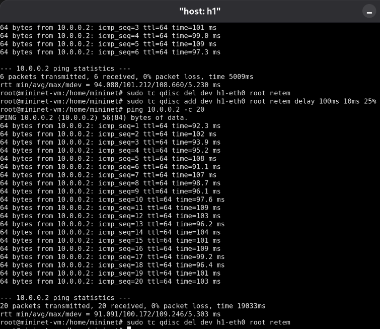{height=60%}

## Распределение задержки в интерфейсе подключения к эмулируемой глобальной сети

Задаем нормальное распределение задержки на узле h1 в эмулируемой сети.
Убеждаемся, что все пакеты, покидающие хост h1 на интерфейсе h1-eth0, будут иметь время задержки, которое распределено в диапазоне 100 мс ±20 мс. Используем для этого команду ping на терминале хоста h1 с параметром -c 10. 
Восстановите конфигурацию интерфейса по умолчанию на узле h1 (Рис. 1.7).

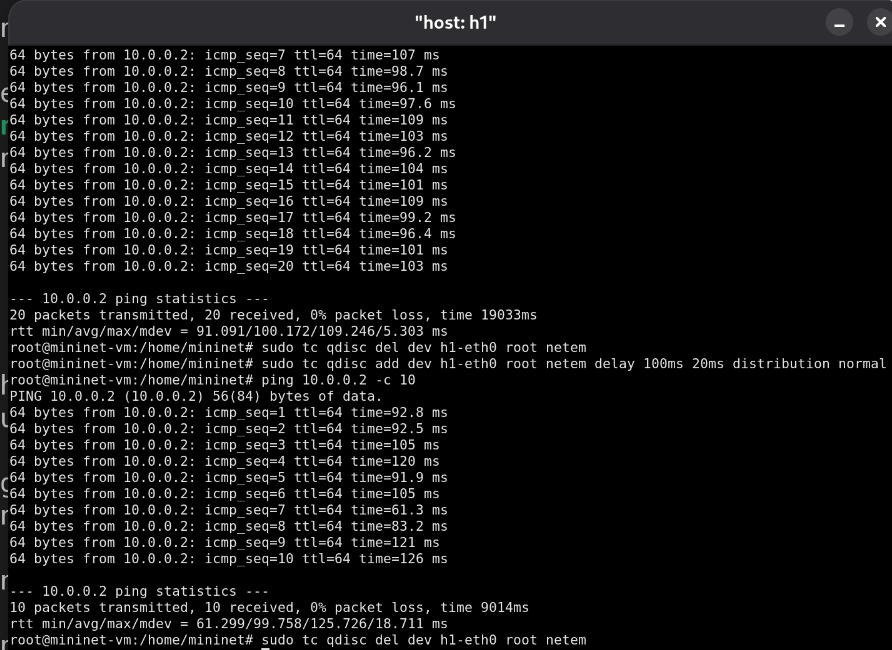{height=60%}

## Добавление задержки для интерфейса, подключающегося к эмулируемой глобальной сети

Обновляем репозитории программного обеспечения на виртуальной машине.
Устанавливаем пакет geeqie.
В виртуальной среде mininet в своём рабочем каталоге с проектами создаем каталог simple-delay и переходим в него.
Создаем скрипт для эксперимента lab_netem_i.py.
Создаем скрипт для визуализации ping_plot результатов эксперимента.
Задаем права доступа к файлу скрипта.
Создаем Makefile для управления процессом проведения эксперимента.
Выполняем эксперимент (Рис. 1.8).

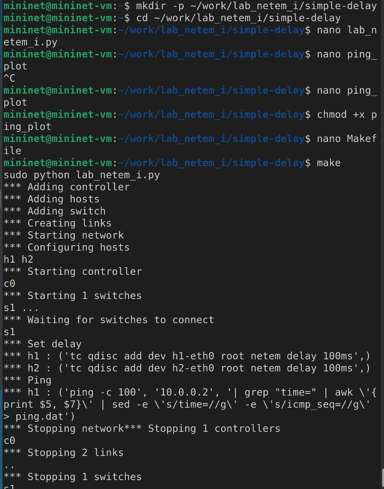{height=60%}

## Добавление задержки для интерфейса, подключающегося к эмулируемой глобальной сети

Демонстрируем построенный в результате выполнения скриптов график (Рис. 1.9).

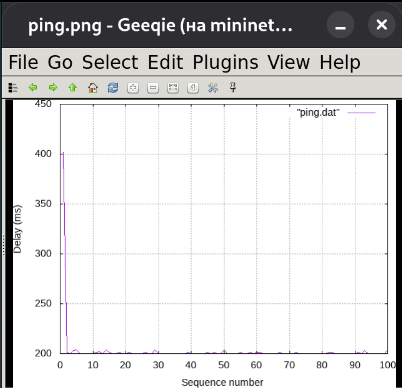{height=60%}

## Добавление задержки для интерфейса, подключающегося к эмулируемой глобальной сети

Из файла ping.dat удаляем первую строку и заново строим график.
Демонстрируем построенный в результате график (Рис. 1.10).

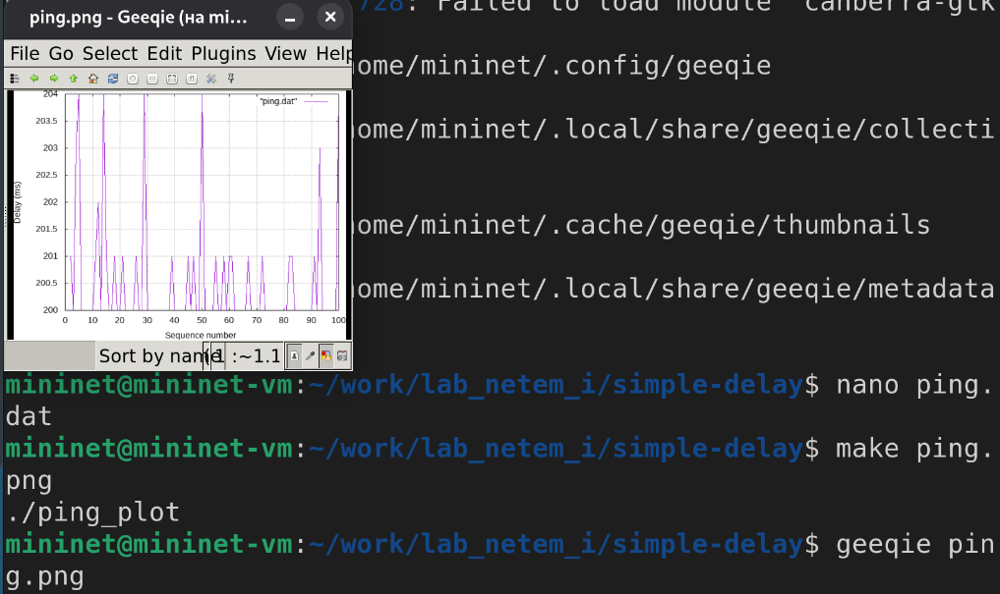{height=60%}

## Добавление задержки для интерфейса, подключающегося к эмулируемой глобальной сети

Разрабатываем скрипт для вычисления на основе данных файла ping.dat минимального, среднего, максимального и стандартного отклонения времени приёма-передачи. Добавляем правило запуска скрипта в Makefile. Демонстрируем работу скрипта с выводом значений на экран (Рис. 1.11).

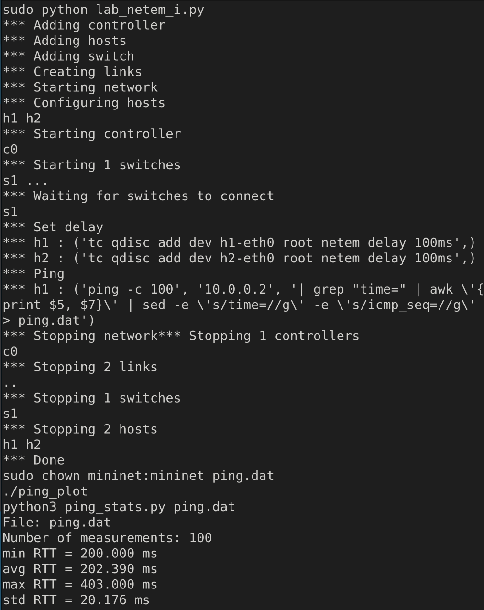{height=60%}

## Задание для самостоятельной работы

Самостоятельно реализуем воспроизводимые эксперименты по изменению задержки, джиттера, значения корреляции для джиттера и задержки, распределения времени задержки в эмулируемой глобальной сети. Строим графики. Вычисляем минимальное, среднее, максимальное и стандартное отклонение времени приёма-передачи для каждого случая (Рис. 1.12), (Рис. 1.13).

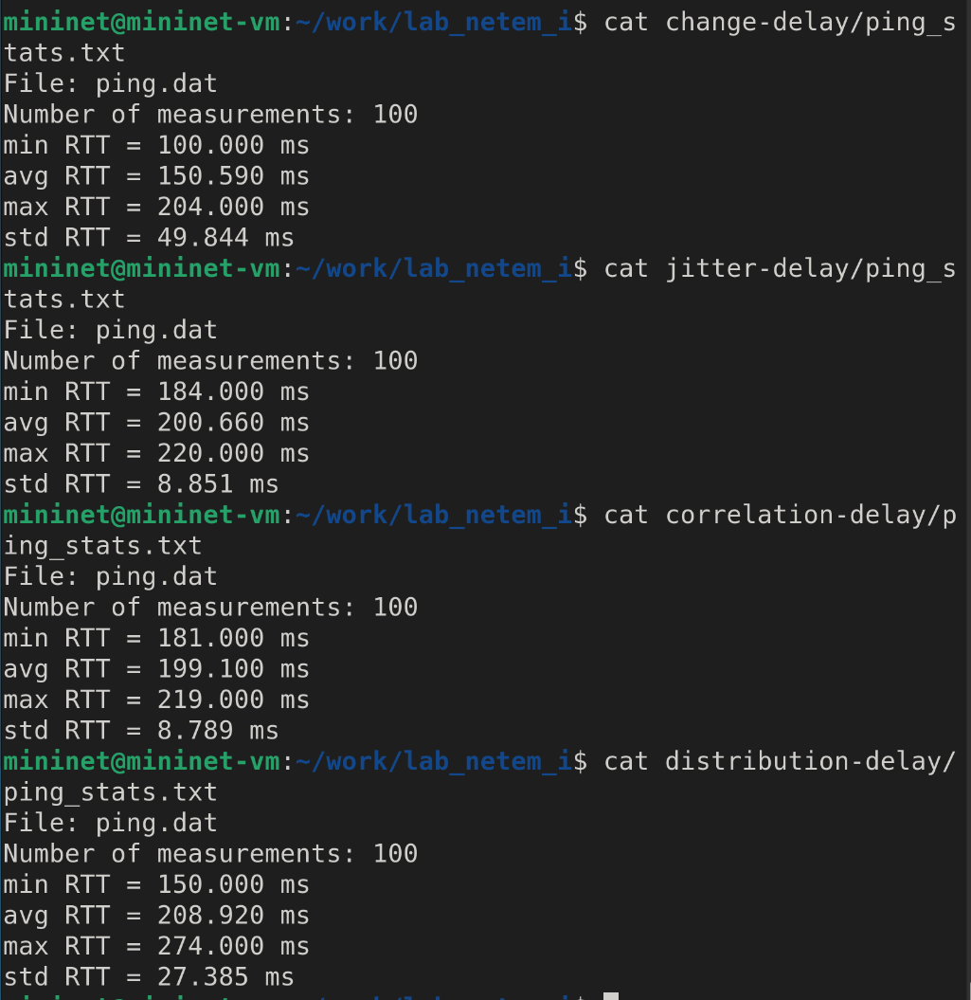{height=60%}

## Задание для самостоятельной работы

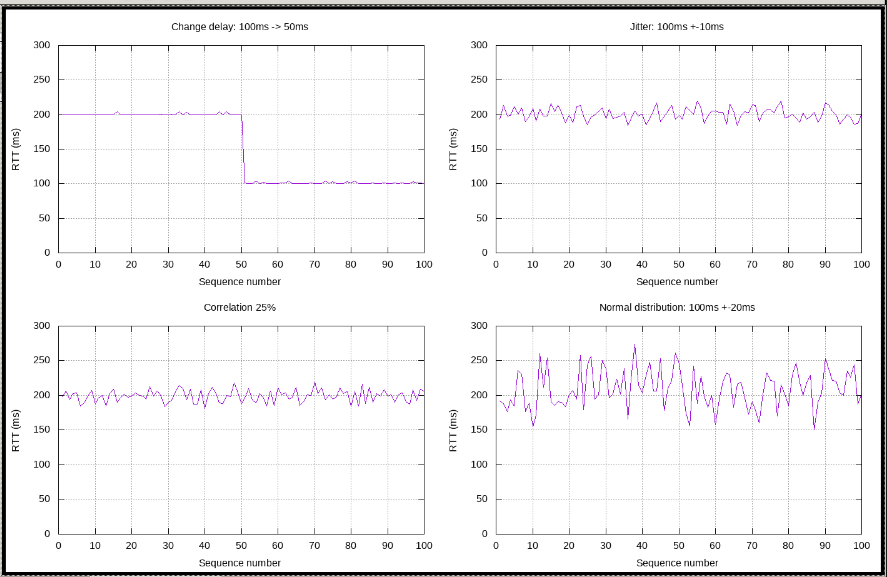{height=60%}

## Выводы

В результате выполнения лабораторной работы я был ознакомлен с NETEM — инструментом для тестирования производительности приложений в виртуальной сети, а также получил навыки проведения интерактивного и воспроизводимого экспериментов по измерению задержки и её дрожания (jitter) в моделируемой сети в среде Mininet.
