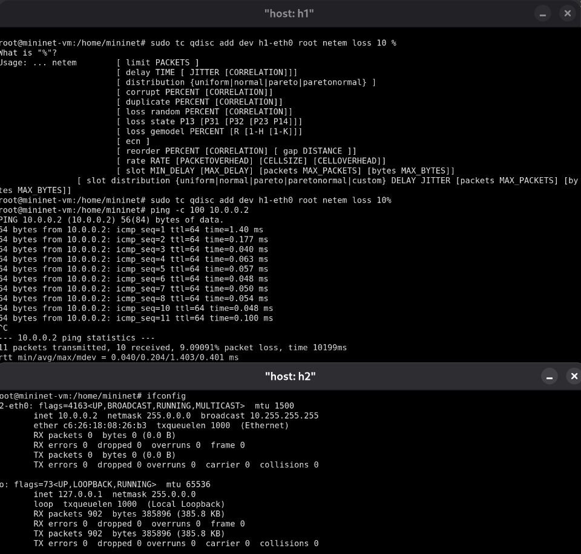
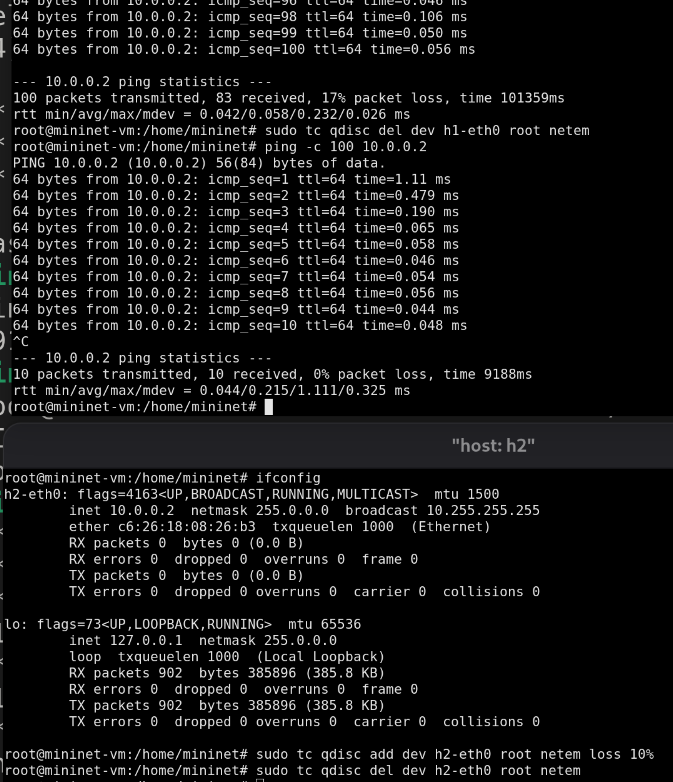
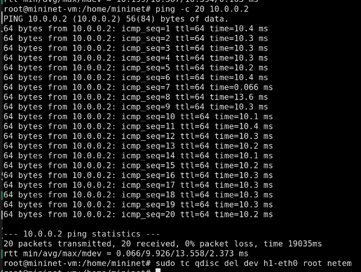
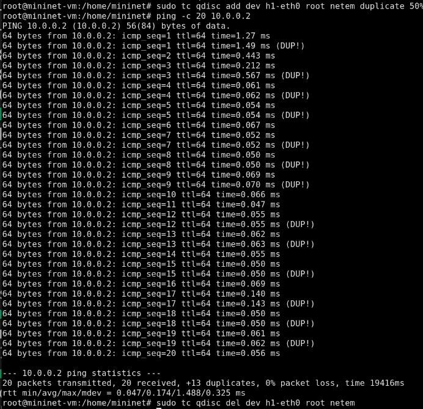
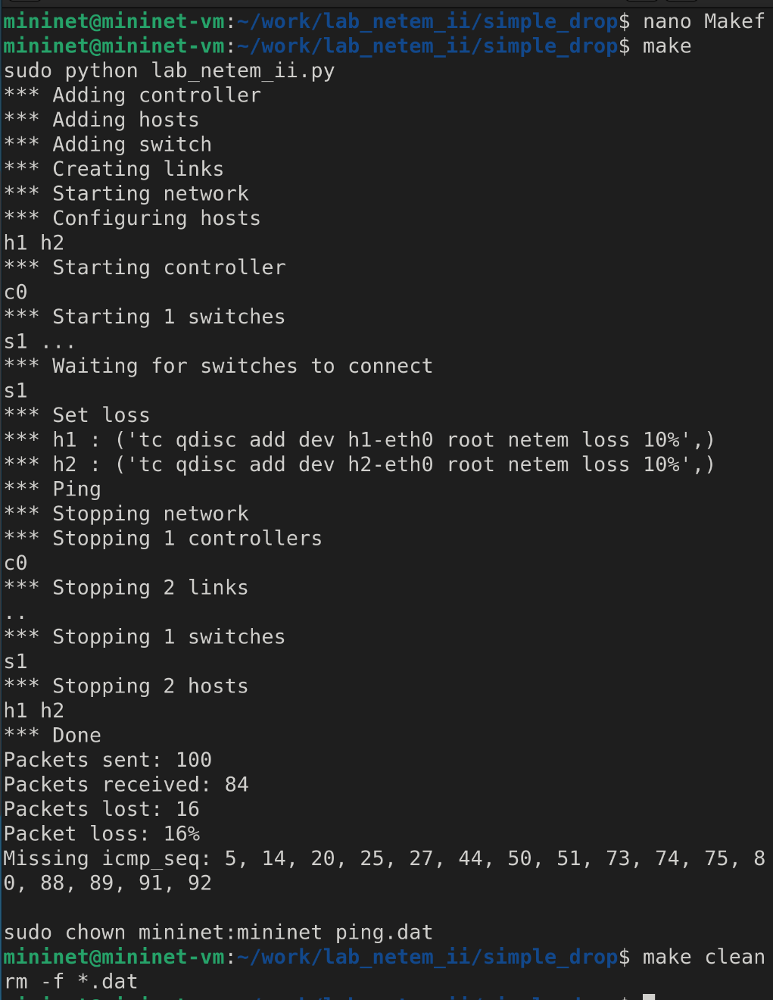
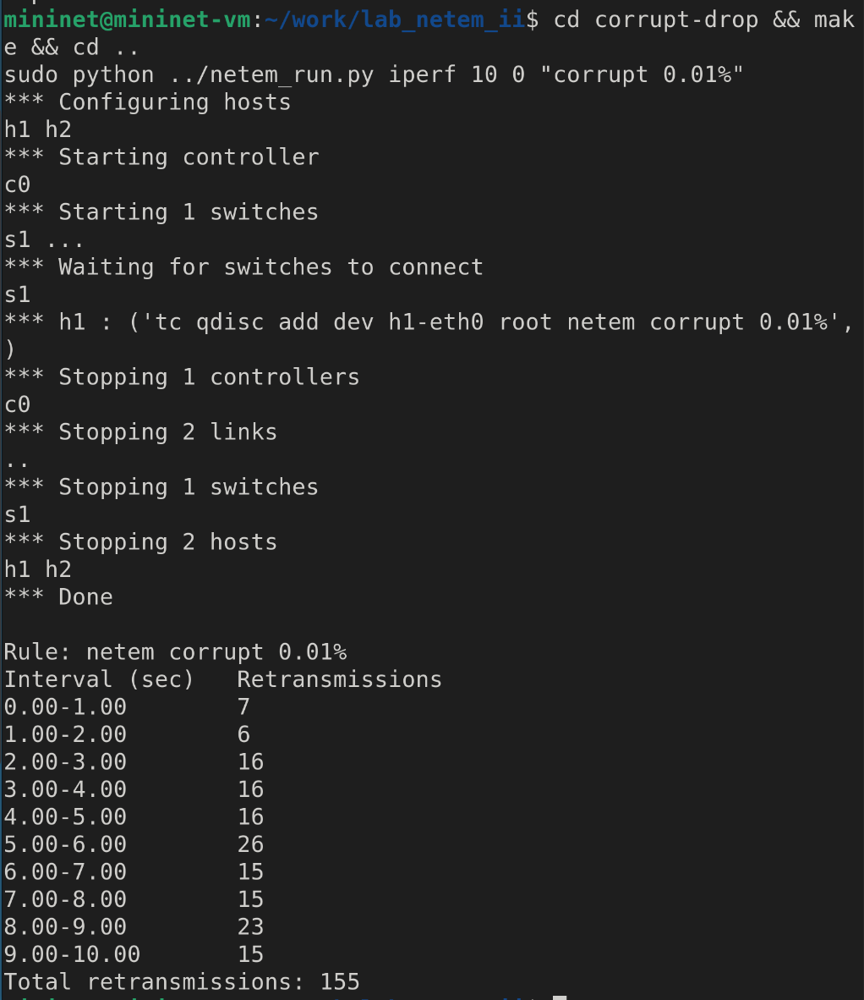

---
## Front matter
lang: ru-RU
title: Лабораторная работа
subtitle: Номер 5
author:
  - Кобзев Д. К. 
institute:
  - Российский университет дружбы народов, Москва, Россия
date: 14 октября 2026

## i18n babel
babel-lang: russian
babel-otherlangs: english

## Pdf output format
fontsize: 8pt

## Formatting pdf
toc: false
toc-title: Содержание
slide_level: 2
aspectratio: 169
section-titles: true
theme: metropolis
##Fonts
mainfont: Liberation Serif
sansfont: Liberation Sans
monofont: Liberation Mono
---

# Информация

## Докладчик

:::::::::::::: {.columns align=center}
::: {.column width="70%"}

  * Кобзев Дмитрий Константинович
  * Студент
  * Российский университет дружбы народов
  * НПИбд-01-23

:::
::: {.column width="30%"}

:::
::::::::::::::

## Цель работы

Целью данной работы является получение навыков проведения интерактивных экспериментов в среде Mininet по исследованию параметров сети, связанных с потерей, дублированием, изменением порядка и повреждением пакетов при передаче данных. Эти параметры влияют на производительность протоколов и сетей.

## Добавление потери пакетов на интерфейс, подключённый к эмулируемой глобальной сети

Запускаем виртуальную среду с mininet.
Из основной ОС подключаемся к виртуальной машине.
В виртуальной машине mininet исправляем права запуска X-соединения.
Задаем простейшую топологию, состоящую из двух хостов и коммутатора с назначенной по умолчанию mininet сетью 10.0.0.0/8.
На хостах h1 и h2 вводим команду ifconfig, чтобы отобразить информацию, относящуюся к их сетевым интерфейсам и назначенным им IP-адресам.
На хосте h1 добавляем 10% потерь пакетов к интерфейсу h1-eth0.
Проверяем, что на соединении от хоста h1 к хосту h2 имеются потери пакетов, используя команду ping с параметром -c 100 с хоста h1. (Рис. 1.1).

{height=60%}

## Добавление потери пакетов на интерфейс, подключённый к эмулируемой глобальной сети

Для эмуляции глобальной сети с потерей пакетов в обоих направлениях добавляем к соответствующему интерфейсу на хосте h2 также 10% потерь пакетов.
Проверяем, что соединение между хостом h1 и хостом h2 имеет больший процент потерянных данных, повторив команду ping с параметром -c 100 на терминале хоста h1.
Восстанавливаем конфигурацию по умолчанию, удалив все правила, применённые к сетевому планировщику соответствующего интерфейса. Для отправителя h1 и для получателя h2.
Убеждаемся, что соединение от хоста h1 к хосту h2 не имеет явной потери пакетов, запустив команду ping с терминала хоста h1 (Рис. 1.2).

{height=60%}

## Добавление значения корреляции для потери пакетов в эмулируемой глобальной сети

Добавляем на интерфейсе узла h1 коэффициент потери пакетов 50%, и каждая последующая вероятность зависит на 50% от последней.
Проверяем, что на соединении от хоста h1 к хосту h2 имеются потери пакетов,
используя команду ping с параметром -c 50 с хоста h1. 
Восстанавливаем для узла h1 конфигурацию по умолчанию, удалив все правила, применённые к сетевому планировщику соответствующего интерфейса (Рис. 1.3).

{height=60%}

## Добавление повреждения пакетов в эмулируемой глобальной сети

Добавляем на интерфейсе узла h1 0,01% повреждения пакетов.
Проверяем конфигурацию с помощью инструмента iPerf3 для проверки повторных передач.
Восстанавливаем для узла h1 конфигурацию по умолчанию, удалив все правила,
применённые к сетевому планировщику соответствующего интерфейса (Рис. 1.4)

{height=60%}

## Добавление переупорядочивания пакетов в интерфейс подключения к эмулируемой глобальной сети

Добавляем на интерфейсе узла h1 следующее правило.
Проверяем, что на соединении от хоста h1 к хосту h2 имеются потери пакетов,
используя команду ping с параметром -c 20 с хоста h1.
Восстанавливаем конфигурацию интерфейса по умолчанию на узле h1 (Рис. 1.5).

{height=60%}

## Добавление дублирования пакетов в интерфейс подключения к эмулируемой глобальной сети

Для интерфейса узла h1 задайм правило c дублированием 50% пакетов.
Проверяем, что на соединении от хоста h1 к хосту h2 имеются дублированные пакеты, используя команду ping с параметром -c 20 с хоста h1.
Восстанавливаем конфигурацию интерфейса по умолчанию на узле h1(Рис. 1.6).

{height=60%}

## Воспроизведение экспериментов

В виртуальной среде mininet в своём рабочем каталоге с проектами создаем каталог simple-drop и переходим в него.
Создаем скрипт для эксперимента lab_netem_ii.py.
Создаем Makefile для управления процессом проведения эксперимента.
Выполняем эксперимент.
Очищаем каталог от результатов проведения экспериментов (Рис. 1.7).

{height=60%}

## Задание для самостоятельной работы

Самостоятельно реализуем воспроизводимые эксперименты по исследованию параметров сети, связанных с потерей, (Рис. 1.8).

{height=60%}

## Задание для самостоятельной работы

изменением порядка (Рис. 1.9).

{height=60%}

## Задание для самостоятельной работы

и повреждением пакетов при передаче данных (Рис. 1.10).

{height=60%}

## Выводы

В результате выполнения лабораторной работы мною были получены навыки проведения интерактивных экспериментов в среде Mininet по исследованию параметров сети, связанных с потерей, дублированием, изменением порядка и повреждением пакетов при передаче данных. Эти параметры влияют на производительность протоколов и сетей.

